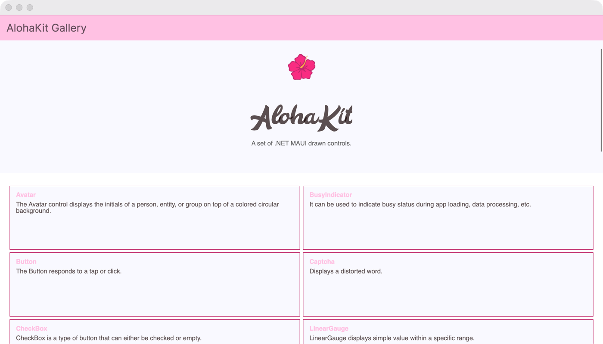

# AlohaKit.Gallery

The gallery app for [AlohaKit](https://github.com/jsuarezruiz/AlohaKit), a set of drawn .NET MAUI controls. It shows avatars, buttons, check boxes, toggle switches, sliders, ratings, segmented controls, gauges, progress indicators and bar, line and pie charts.

