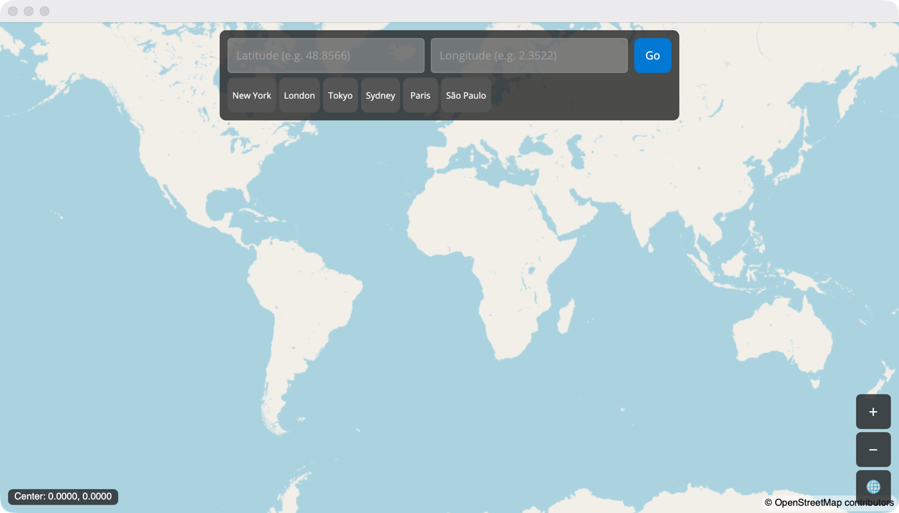

# MapApp

An interactive OpenStreetMap map built with [Mapsui](https://github.com/Mapsui/Mapsui) and rendered through the Avalonia SkiaSharp views. You can type a latitude and longitude, jump to a preset city or use the zoom controls. The current map center is shown in the corner.

